# Steam Account Switcher

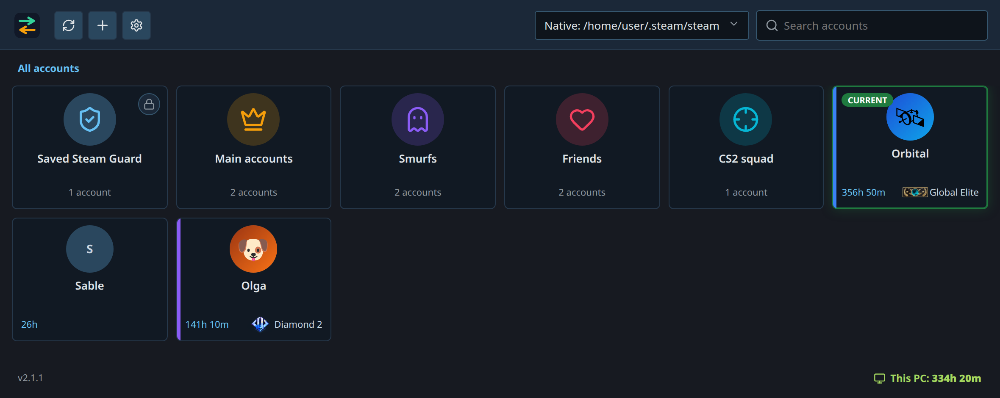

Unlimited Steam accounts, switched in one click.

The application lists the accounts your Steam client already remembers, switches
the account Steam logs into on its next start (restarting the client for you),
and keeps a local playtime history per account, game, day and session.

- [**Rank badges**](#account-details) for Marvel Rivals, Overwatch, Counter-Strike 2
  and Counter-Strike 2 Premier.
- [**Account list**](#your-accounts) ordered by last login, with folders to group
  accounts.
- [**Steam Guard**](#steam-guard) authenticators, to secure your accounts or to
  import one you already use from its `.maFile` backup.
- [**Playtime history**](#playtime) kept on this computer, per account, game, day
  and session.
- [**29 languages**](#settings), the ones Steam speaks: the system language or
  a saved one in Settings → Preferences.
- [**Linux and Windows**](#download): AppImage, RPM, portable `.exe` or installer,
  tray icon, start with the system, and updates from the app itself.

Switching accounts is still a regular Steam sign-in: the switcher never reads or
stores your password.

## Related project

[Steam Guard Desktop](https://github.com/SunkwiBOT/steam-guard-desktop) is a
separate application dedicated to Steam Guard only: an authenticator for Linux,
Windows and macOS with the same encrypted vault and the same `.steamguard`
backups. The two applications are not linked, but a backup exported from one
imports into the other.

## Your accounts

The list is ordered by last login. Hover an account to show its **eye** button in
the top-right corner, which opens its details. Double-click an account to switch to
it, and right-click it for a menu of actions.

Accounts removed from Steam but still holding an authenticator stay in the app, in
a folder that cannot be edited, where their Steam Guard codes remain viewable.

Folders appear in the same list, with their own colour and icon. Open one to see
its accounts, or right-click it to edit or delete it. Deleting a folder keeps its
accounts and returns them to the main list. Each account can also have its own
colour.

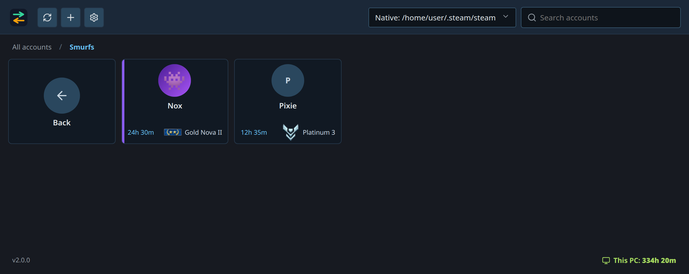

The search field follows the page you are on. On **All accounts** it looks in
every account, including the ones filed in a folder, and each result shows the
folder it comes from:

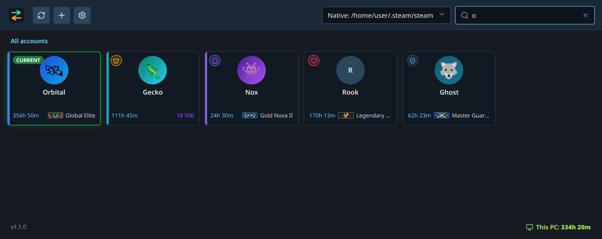

## Account details

The details of an account open from its eye button. They show the sign-in name
with reveal and copy, the last login, local playtime, rank, folder, colour, and the
actions for switching, viewing playtime and removing the account.

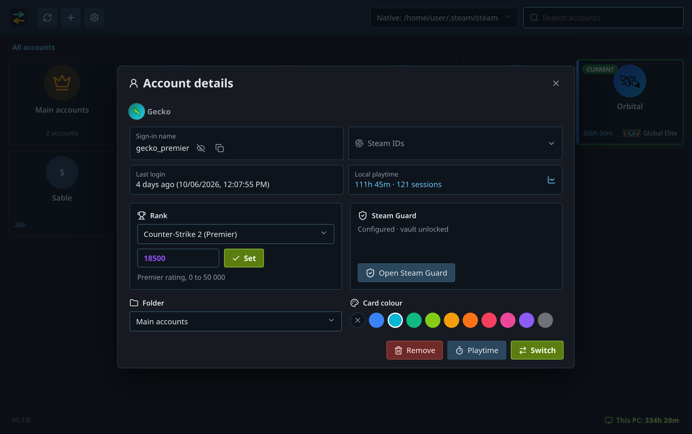

**Steam IDs** opens the full identifier list — SteamID 64, account ID, Steam2 and
Steam3, the profile and invite links, and the FiveM/HEX form.

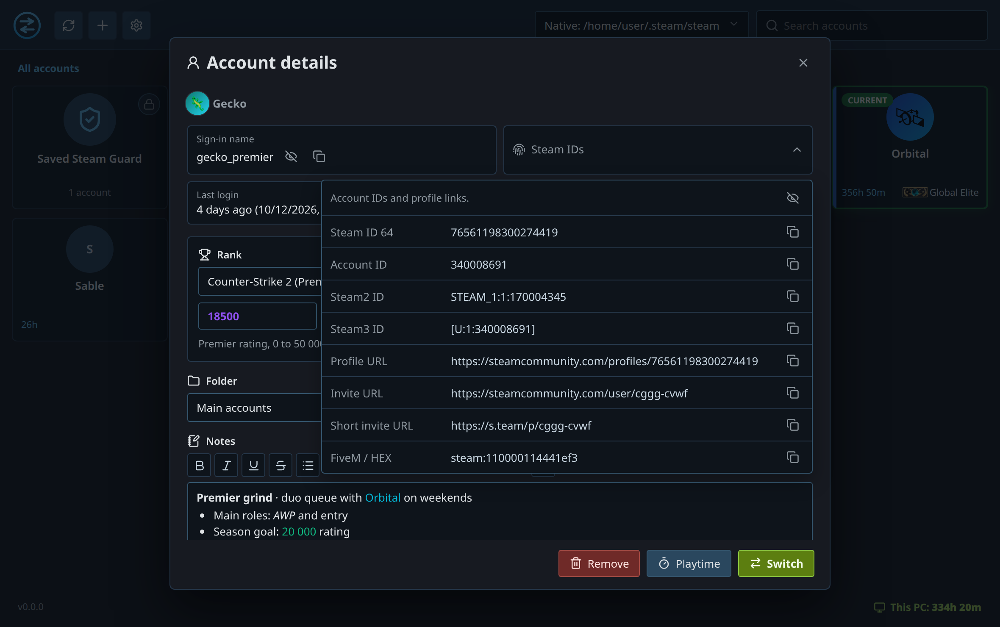

## Playtime

Playtime is recorded locally while the app runs, including in the notification
area. Reports exist per account: games, daily chart, session history, totals and
averages.

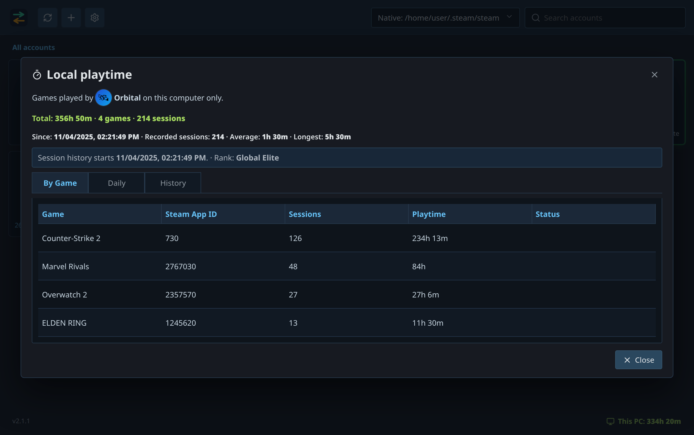

Tracking can be turned off, which keeps the recorded history and hides playtime
throughout the interface. The data stays on this computer. Deleting it requires a
confirmation and never touches Steam sign-ins or the vault.

## Steam Guard

An account does not have to use an authenticator. Without one, its Steam Guard
panel offers to import an existing `.maFile` backup or to link a new
authenticator (password or QR login, then the SMS or e-mail code). With one, the
panel generates the rotating 5-character code locally with a countdown, lists
pending trade and market confirmations, and offers the security actions:
transfer, remove, revoke, reveal or copy the revocation code.

Accounts with an authenticator set up in the app stay accessible even when the
account no longer exists in the Steam client. They are moved into a folder managed
by the app, so you can still view their Steam Guard codes.

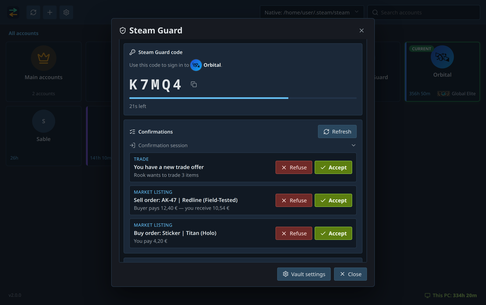

The rotating codes are generated on this machine. The app pauses and blurs its
code when it loses focus, then refreshes on return.

- **Vault**: every secret lives in one local vault. It works without a password
  by default; adding one encrypts the vault with Argon2id and AES-256-GCM. Each
  action on secrets asks for the password only while the vault is locked.
  Settings, folders, ranks, the vault and playtime history are all stored in a
  single SQLite database in the application's configuration folder.
- **Portable backups**: export one authenticator or all of them to a single
  `.steamguard` file, protected by an independent backup password (or explicitly
  unprotected), and import it on Linux or Windows. Import adds new
  authenticators and keeps existing ones.
- **Quick copy**: accounts with an authenticator have a shield action on hover
  that copies a code, even while the vault is locked.

Steam Guard is a security boundary. Keep a backup of the vault **and** write down
each revocation code: losing both means the authenticator can only be removed by
Steam Support. Linking, transferring or revoking an authenticator also triggers
Steam trade and market holds, from 2 to 15 days depending on Steam's rules.

## Settings

**Preferences** holds the language, the search fields, startup and closing, and
privacy. The search fields choose what the search bar compares: the display name,
the Steam identifier (sign-in name and Steam ID), or both. Hiding sign-in names or
Steam IDs applies everywhere, including reports.

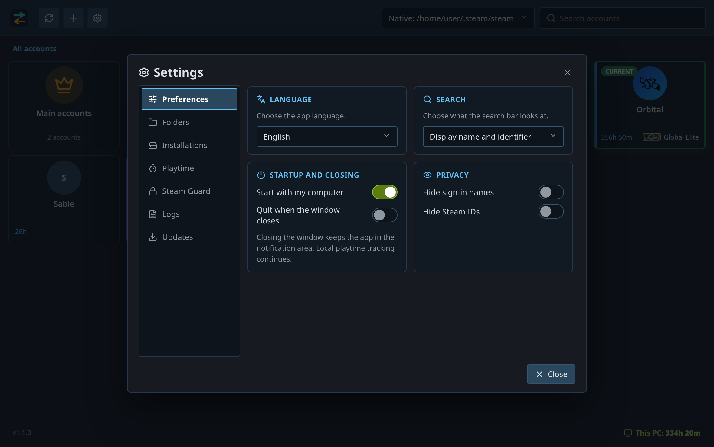

**Folders** lists every folder with its icon, its account count and its edit and
delete actions. Editing changes the name, the colour and the icon.

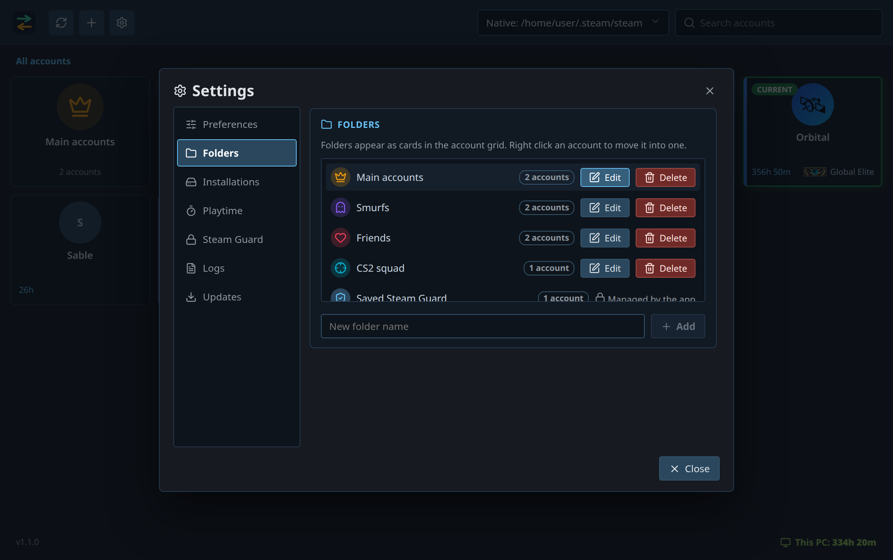

**Installations** finds the Steam installations on this computer: switch between
them from the header, hide the ones you do not use, or add a folder by hand (it
must contain `config/loginusers.vdf`).

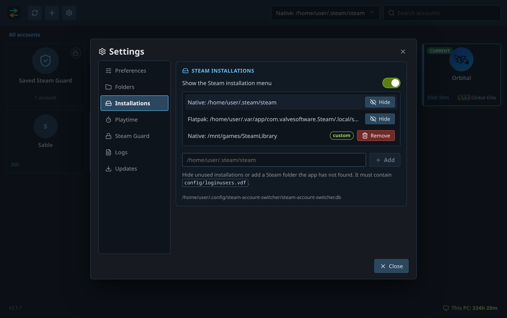

**Playtime** turns tracking on or off, copies the local data paths, and deletes
the recorded playtime of every known installation after a confirmation. These
actions only concern the app's own data: they never change your Steam sign-ins or
your accounts in Steam.

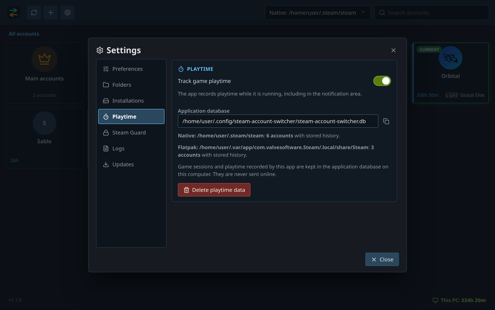

**Steam Guard** holds the vault, where all authenticator secrets are stored.
Protect it with a password to encrypt them.

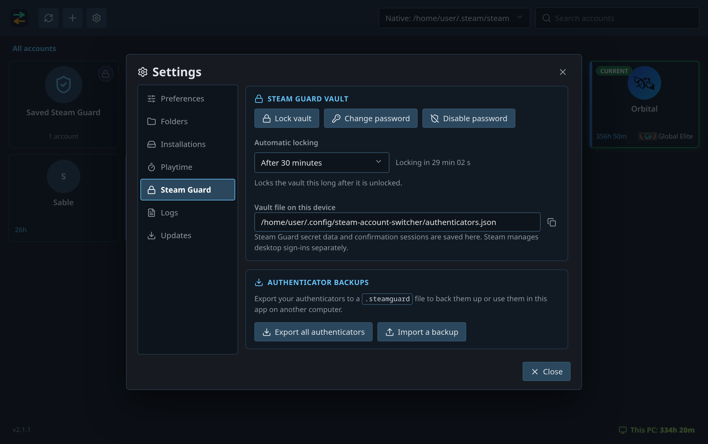

**Logs** shows the current or previous log, its path, a refresh action and a
button to open the folder. Actions record their start, result, duration and a
fixed error category. Command arguments, account names, passwords, codes, tokens
and request URLs are never recorded.

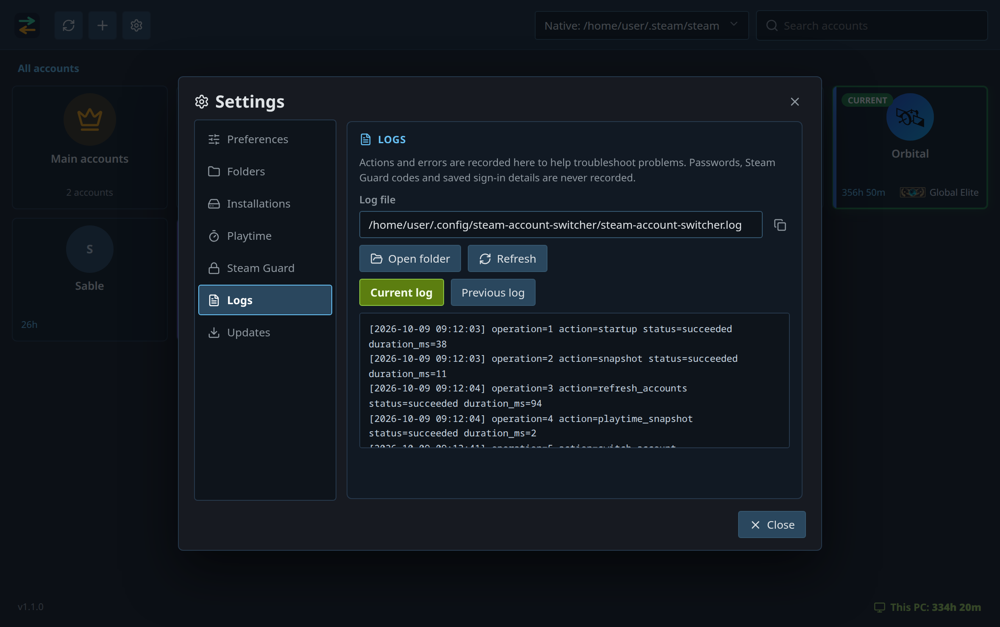

**Updates** shows the installed version, the last check, a manual check and the
automatic check frequency. Downloads and restarts always require your action.

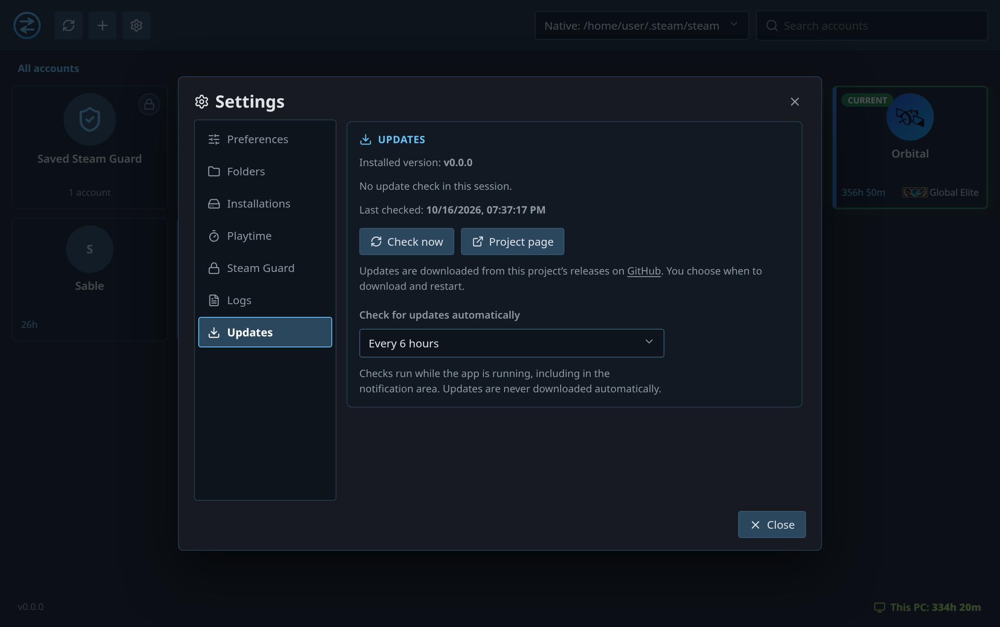

Closing the window either quits the app or keeps it in the notification area;
local playtime tracking stops when the app quits, whichever you choose.

## Download

Builds are on the
[releases page](https://github.com/SunkwiBOT/steam-account-switcher/releases).
Linux gets an AppImage and an RPM; Windows gets a portable `.exe` or an installer.

## Build

```bash
npm ci
npm run dev:app     # application, interface hot reloaded
npm run build:app   # release executable with the interface embedded
```

Rust and Node 22.12 or newer, plus the
[Tauri prerequisites](https://v2.tauri.app/start/prerequisites/) for your system.

## Translations

The UI uses Paraglide with `messages/en.json` and `messages/fr.json`.
`project.inlang/settings.json` declares the supported languages and the message
format. Vite generates the typed modules under `ui/src/lib/paraglide/` during
`npm run dev` or `npm run build`; generated modules and plugin caches are ignored.
Add the same message key and inputs to both catalogues. Use complete sentences
and plural variants rather than joining translated fragments. `t` reads the
active language reactively; `rich` and `MessageText` keep interpolated values
bold and render user data as plain text. Format counts before passing them to
`rich` when the catalogue message uses a plural selector.

The tray uses rust-i18n with `src-tauri/locales/en.json` and `fr.json`. Native
commands return stable error codes defined in `steam-core/src/error_code.rs`.
`ErrorApiMessage` and the exhaustive resolver in `ui/src/lib/errors.svelte.ts`
map these codes to translated messages. Unknown errors show a generic message;
raw SDK errors and sensitive payloads are never displayed or logged. Account
names, game names and content supplied by Steam or release notes keep their
original wording.

## License

MIT — see [LICENSE](LICENSE).

## Disclaimer

This is an independent, unofficial tool. It is not affiliated with, endorsed by
or sponsored by Valve Corporation, Blizzard Entertainment, Marvel, NetEase or
any other game publisher.

Steam, Counter-Strike 2, Overwatch, Marvel Rivals and their names, logos and
rank artwork are trademarks or registered trademarks of their respective
owners. The rank badges bundled in `ui/public/ranks/` are used only to identify
the games they belong to, and all rights to them stay with their owners.

Use it at your own risk. Account switching leaves the sign-in to Steam and never
reads or stores your password. The optional Steam Guard authenticator stores
authenticator secrets locally: it relies on Steam's reverse-engineered mobile
API, which is unofficial, may change or stop working at any time, and defeats
the purpose of a phone-based second factor if this machine is compromised.
Without a vault password, those secrets are readable on disk by anyone who can
access the database file. Keep your vault and revocation codes safe.
